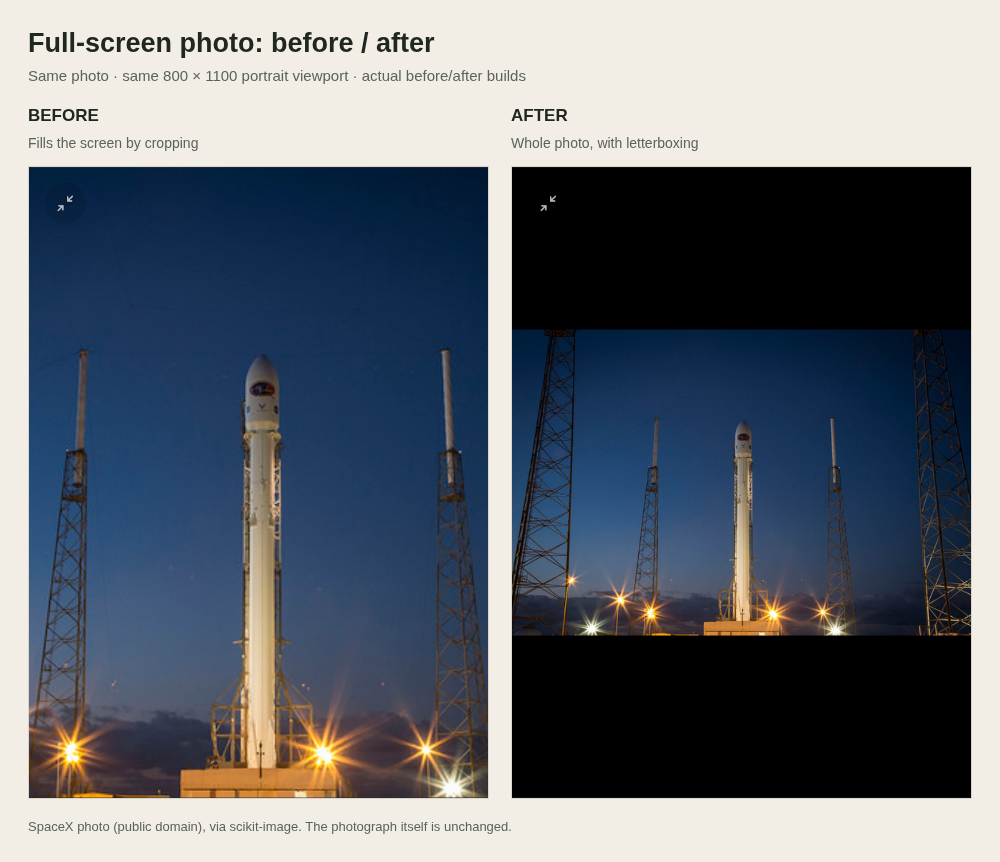
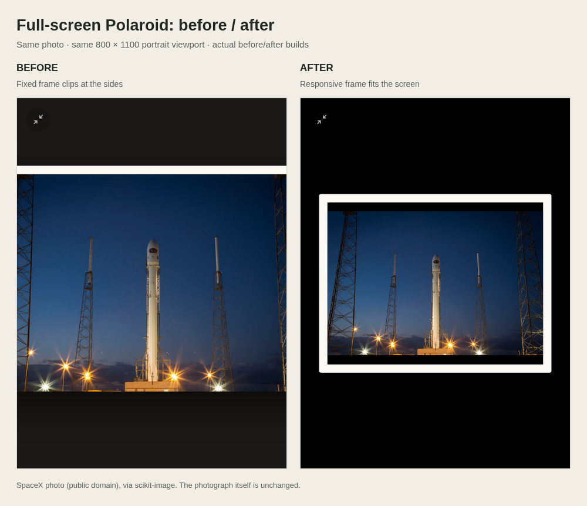

# Photo fitting: before and after

These comparisons use the **same real photograph** in the actual before and after application builds. Left is **before** (`50b6bd0`); right is **after** (`f6e015a`). Both builds use the same local Chromium, fixed clock, random seed, photo metadata, full-screen state and **800×1100 portrait viewport**. The photograph is not retouched. This viewport makes cropping and fixed-frame overflow particularly easy to see.

## Single full-screen photo

## Polaroid in full screen

## Photograph and provenance

`source-rocket.jpg` is SpaceX's DSCOVR/Falcon 9 launch photograph, released into the public domain. It is the unmodified sample from [scikit-image v0.18.3](https://github.com/scikit-image/scikit-image/blob/v0.18.3/skimage/data/rocket.jpg). Its [dataset documentation](https://github.com/scikit-image/scikit-image/blob/v0.18.3/skimage/data/__init__.py) identifies [SpaceX's original photograph](https://www.flickr.com/photos/spacexphotos/16511594820/in/photostream/) and its public-domain status. These are sample images, not household photos.

## Validation status

These are review illustrations, **not Playwright CI baselines**. Synthetic edge-marked fixtures remain in the automated geometry tests, where they make clipping detectable.

CI baselines must be rendered in `mcr.microsoft.com/playwright:v1.65.0-noble`, as required by `frontend/tests/screens/README.md`. That image's download host was blocked during preparation of this branch. Regenerate the affected existing screenshots and the two new full-screen Polaroid baselines with `npm run test:screens:docker:update`, then run `npm run test:screens:docker` before marking this PR ready.
