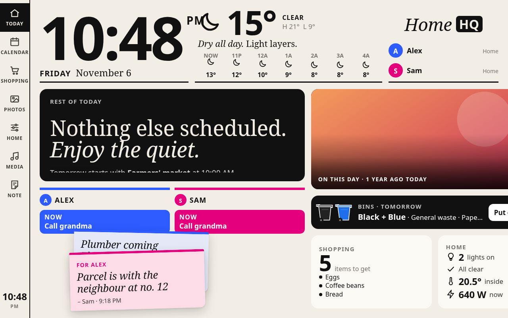
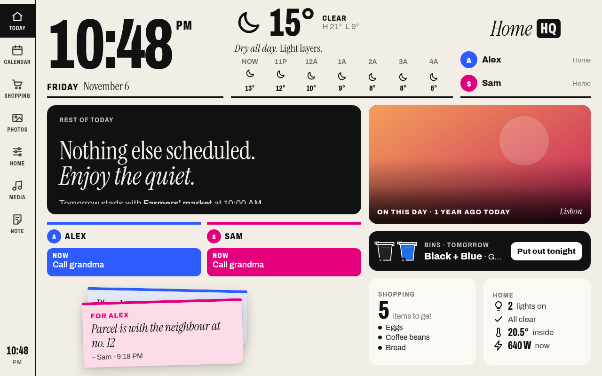

# Frame layout comparison

1280×800, desktop Chromium, external requests blocked, same demo API, clock fixed
at 10:48 PM, night tint disabled, and deterministic photo selection.
These captures show layout differences; they do not establish Android WebView
rendering quality or reproduce the tablet's intermittent blur.

| Before (`aa8ac9f`) | After (`4bd4b19`) |
| --- | --- |
|  |  |

Fonts are unavailable in the original offline view. The fixed view serves them
locally. Grid constraints keep the right-hand cards inside the frame, and the
weather icon row reserves space for the temperature curve.
